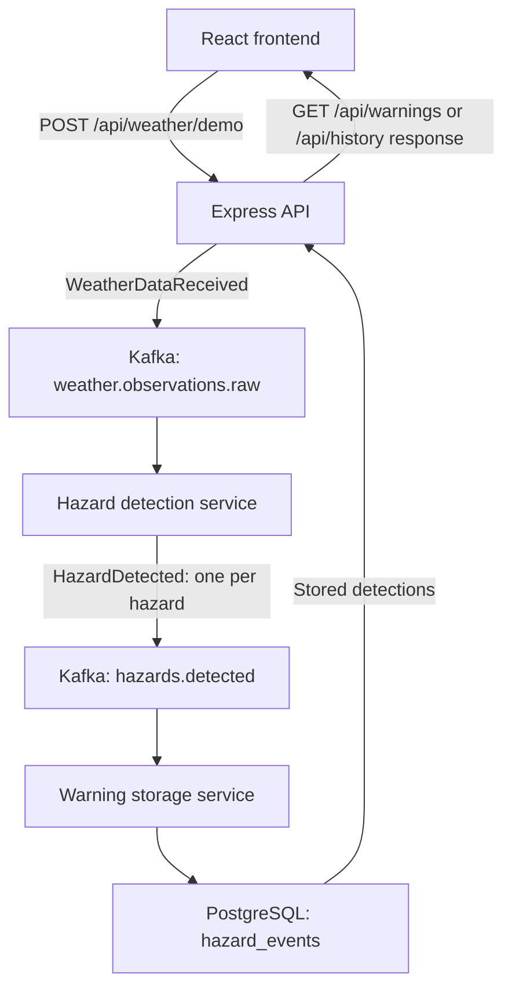

# Weather Sentry
### Application Demonstration & Technical Walkthrough

**ENSF 607 · React · Express · Apache Kafka · PostgreSQL · Docker Compose**

> **Demo focus:** Submit a weather observation, detect hazards asynchronously, save the results, and display them in the application.

---

## 1. Application Overview

Weather Sentry demonstrates an **event-driven weather hazard detection pipeline**. The user submits sample weather data through a React interface. Independent backend services process the observation through Kafka, detect threshold violations, and store hazard records in PostgreSQL for the interface to retrieve.

| Component | Responsibility |
| --- | --- |
| **React frontend** | Displays the dashboard, submits demo observations, and retrieves stored detections. |
| **Express API** | Receives HTTP requests, publishes weather events, and reads stored hazards. |
| **Apache Kafka** | Carries events between independently running services. |
| **Hazard detection service** | Validates observations and checks temperature and wind thresholds. |
| **Warning storage service** | Consumes detected hazards and inserts them into PostgreSQL. |
| **PostgreSQL** | Persists hazard records in the `hazard_events` table. |
| **Docker Compose** | Starts the frontend, backend services, Kafka, and database together. |

The current version uses **synthetic weather observations and fictional shelter data**. Its displayed detections are demonstration records, not official emergency warnings.

## 2. Start the Demonstration

Run these commands from the repository root, with Docker running and the required database settings configured in `.env`.

### Build and start

```bash
docker compose up -d --build
docker compose ps
```

Wait for Kafka, PostgreSQL, and the API to report healthy. The one-time `kafka-init` service should finish successfully; the frontend and processing workers should be running.

| Screen | Local URL | What to show |
| --- | --- | --- |
| **Dashboard** | http://localhost:5173/ | City selection, stored weather readings, hazard summaries, map, and sample shelters. |
| **Detected hazards** | http://localhost:5173/warnings | Submit observations and refresh the stored detections. |
| **Alert history** | http://localhost:5173/history | Review persisted hazard records. |

### Optional: reset to a clean demo

```bash
docker compose down -v
docker compose up -d --build
```

**Reset effect:** `down -v` deletes this Compose project's stored PostgreSQL data and Kafka data. Use this only when intentionally clearing previous demo runs. To stop while keeping data, use `docker compose down`.

## 3. Live UI Walkthrough

1. **Open the dashboard.** Introduce the city selector, hazard summaries, map, and fictional shelters. A clean database initially has no stored detections.
2. **Open Detected hazards.** Use the default observation: **Calgary, 38 °C, 80 km/h**.
3. **Select “Send demo weather.”** Explain that the API queues an event in Kafka and the processing services run asynchronously.
4. **Wait briefly, then select “Refresh.”** Expect two new records: **Extreme heat** and **High wind**.
5. **Return to the dashboard.** Select Calgary and use **“Refresh data”**, or wait for the automatic refresh every **45 seconds**.
6. **Open Alert history.** Show that the same detections are retrieved from PostgreSQL. Restarting the stack without removing volumes preserves the stored data.

**Presenter talking point:** One weather observation can produce multiple hazard events. The interface retrieves those saved results after the background pipeline finishes.

## 4. Event Architecture & Data Flow



### Step 1 — Load the frontend

The dashboard calls `getWarnings()` and `getShelters()` when it loads. These send `GET /api/warnings` and `GET /api/shelters` requests. Dashboard data is also refreshed every 45 seconds and through its manual refresh button.

**Files:** `frontend/src/api.js` · `frontend/src/pages/Dashboard.jsx`

### Step 2 — Submit an observation

The Detected hazards page calls `publishDemoWeather()` with a location, temperature, and wind speed. The API validates the input and creates a `WeatherDataReceived` event with a unique `eventId` and an observation timestamp.

**Files:** `frontend/src/pages/Warnings.jsx` · `services/api/src/app.js`

### Step 3 — Publish to Kafka

The API calls `sendWeatherEvent(event)`, publishing the observation to **`weather.observations.raw`**. The message key is the observation's location.

The API responds with **HTTP 202 Accepted** and the weather event ID. This confirms publication to Kafka; hazard detection and database storage may still be in progress.

**File:** `services/api/src/kafka.js`

### Step 4 — Detect hazards

The hazard detection service consumes raw weather events and calls `processWeatherEvent()`, which passes `event.data` to `detectHazards()`. The detector validates the observation and checks the configured thresholds.

For each detected hazard, the processor creates a new event:

```javascript
{
  eventType: "HazardDetected",
  eventId: randomUUID(),
  sourceEventId: event.eventId,
  data: hazard
}
```

Each hazard has its own ID. **`sourceEventId` links related hazards to the original weather observation.** If no threshold is met, no hazard events are emitted.

**Files:** `services/hazard-detection/hazardDetectionService.mjs` · `processWeatherEvent.mjs` · `detectHazards.mjs` · `hazardConfig.mjs` (all under `services/hazard-detection/`)

### Step 5 — Publish and store detections

The detector publishes each hazard event to **`hazards.detected`**, again using location as the message key. The warning storage service consumes that topic and inserts the event into PostgreSQL.

Stored fields include the hazard event ID, source weather event ID, hazard type, location, available measurements, timestamps, and full event payload. `ON CONFLICT (event_id) DO NOTHING` prevents duplicate inserts when the **same hazard event ID** is delivered again.

**Files:** `services/hazard-detection/hazardDetectionService.mjs` · `services/warning-storage/storageService.mjs` · `shared/hazardSchema.mjs`

### Step 6 — Retrieve and display results

The API reads PostgreSQL when the frontend requests warnings or history. The dashboard groups related detections by their source event ID to combine available temperature and wind readings.

**Refresh behavior:** The Detected hazards page requires a manual refresh after submission. The dashboard supports manual refresh and 45-second polling. The current frontend does **not** retain the submission response's event ID to poll for a matching result.

**Files:** `services/api/src/db.js` · `frontend/src/pages/Warnings.jsx` · `frontend/src/pages/Dashboard.jsx` · `frontend/src/utils/dashboardData.js`

## 5. Hazard Rules & Simulations

Thresholds are defined in `services/hazard-detection/hazardConfig.mjs`.

| Hazard | Detection rule | Boundary behavior |
| --- | --- | --- |
| **Extreme heat** | Temperature **≥ 35 °C** | Exactly 35 °C triggers detection. |
| **Extreme cold** | Temperature **≤ −30 °C** | Exactly −30 °C triggers detection. |
| **High wind** | Wind speed **≥ 70 km/h** | Exactly 70 km/h triggers detection. |

### Suggested demo inputs

| Temperature | Wind speed | Expected new detections per submission |
| --- | --- | --- |
| 38 °C | 80 km/h | Extreme heat + High wind |
| −35 °C | 80 km/h | Extreme cold + High wind |
| 35 °C | 20 km/h | Extreme heat — demonstrates an inclusive boundary |
| 20 °C | 20 km/h | None — existing stored detections remain visible |

### Automated hazard checks

The simulation tests in `services/hazard-detection/detectHazards.test.mjs` cover individual hazards, simultaneous hazards, normal weather, threshold boundaries, and invalid inputs.

Run the detector and event-processing tests from the repository root:

```bash
npm --prefix services/hazard-detection test
```

These unit tests exercise detection and event creation without requiring the Docker stack.

## 6. API Quick Reference

| Method | Endpoint | Purpose |
| --- | --- | --- |
| `GET` | `/api/health` | Confirms API reachability; does not verify every worker. |
| `POST` | `/api/weather/demo` | Publishes a synthetic weather event; returns `202` with its `eventId`. |
| `GET` | `/api/warnings` | Retrieves the latest 30 stored hazard detections. |
| `GET` | `/api/history` | Retrieves the latest 100 stored hazard detections. |
| `GET` | `/api/shelters` | Returns fictional shelter records; supports an optional `city` filter. |

To follow the backend processing during the demonstration:

```bash
docker compose logs -f api hazard-detection warning-storage
```

## 7. Current Scope & Key Takeaway

**Implemented:** Synthetic event submission, Kafka messaging, threshold detection, PostgreSQL persistence, API retrieval, dashboard refresh, and sample shelter/map visualization.

**Future work:** Live weather ingestion, official warning issuance and delivery, real shelter feeds, routing, and user authentication. Several corresponding service directories are placeholders in this repository. Map hazard markers represent city centers, not measured hazard boundaries.

> **Key takeaway:** Weather Sentry connects a user-facing application to an asynchronous processing pipeline: submit an observation, detect hazards through Kafka, persist the results, and display them through the API.

---

*Prepared from the supplied project check-in notes and cross-checked against the accompanying repository snapshot. File paths are relative to the repository root.*
